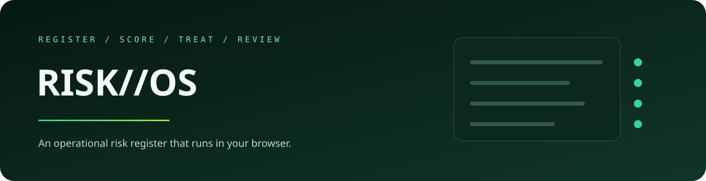
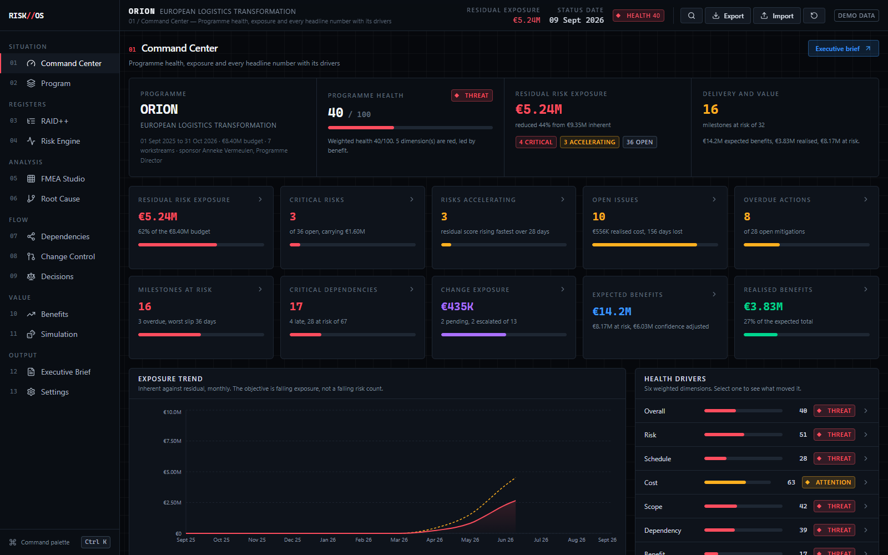
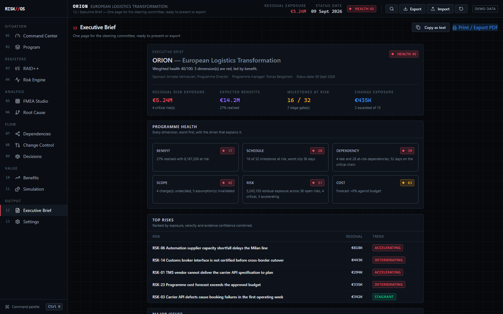
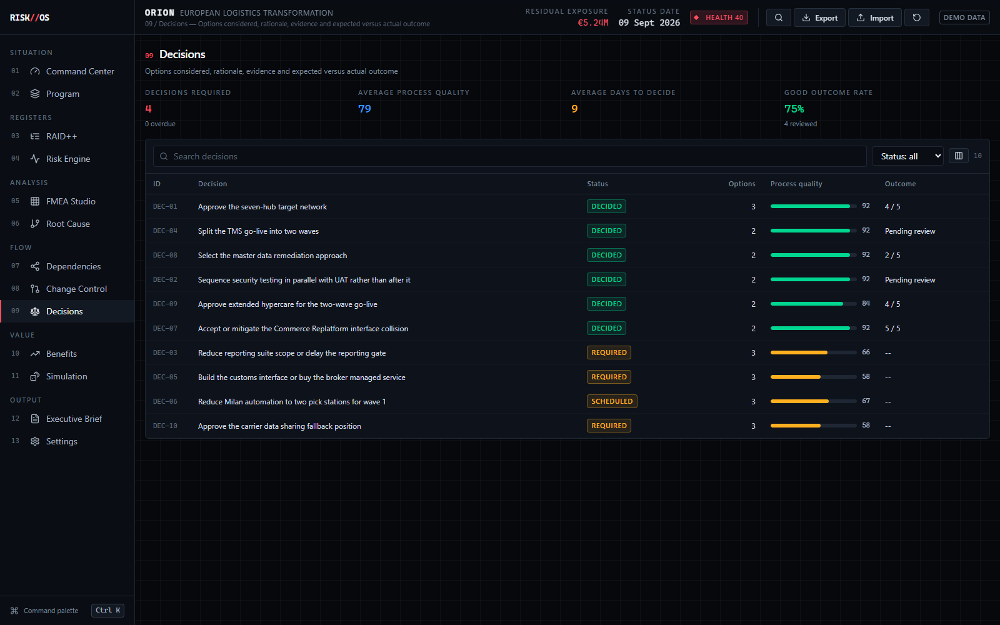
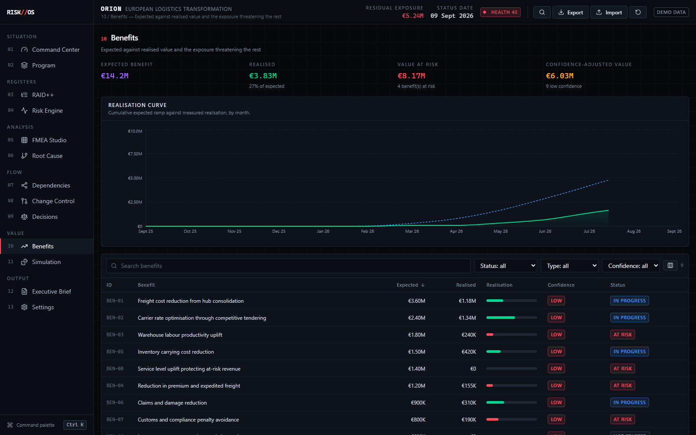
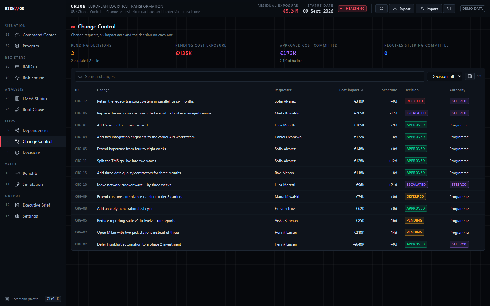

<p align="center">
  
</p>

<p align="center">
  <a href="https://jeevan-0508.github.io/risk-os/">Open the live tool</a> ·
  <a href="#the-operating-loop">Operating loop</a> ·
  <a href="#run-locally">Run locally</a>
</p>

# RISK//OS

### An operational risk register that runs in your browser.

RISK//OS gives a programme team one place to register risks, score exposure, assign treatment, record decisions, and return to the review cycle. It is deliberately lightweight: no account, no server, no telemetry.

`BROWSER-FIRST` · `OFFLINE-FRIENDLY` · `RISK REGISTER` · `REVIEW CYCLES`

## Start with the product

**[Open the live tool →](https://jeevan-0508.github.io/risk-os/)**

The demo is designed for the first ten minutes of a real risk conversation: see the portfolio, open a risk, understand the treatment plan, and leave with a decision that has an owner and a next review.

## The operating loop

<p align="center"></p>

<table>
  <tr>
    <td width="50%"><br><strong>See the portfolio</strong><br>Start with the risks that need attention now.</td>
    <td width="50%"><br><strong>Make the call visible</strong><br>Record the decision, rationale, owner, and review date.</td>
  </tr>
  <tr>
    <td width="50%"><br><strong>Connect risk to value</strong><br>Keep mitigations tied to the programme outcome they protect.</td>
    <td width="50%"><br><strong>Track movement</strong><br>See what changed and why instead of treating the register as a static list.</td>
  </tr>
</table>

## Why it matters

A risk register is useful when it changes a conversation. RISK//OS keeps the operational details close enough to act on while preserving the context needed to challenge a score or revisit a treatment plan.

<details>
<summary><strong>Implementation notes</strong></summary>

The app is a React and TypeScript browser application with local state, charts, and a responsive command center. It is a practical decision surface, not a replacement for an organisation’s risk policy, controls, or governance process.

</details>

## Run locally

```bash
bun install
bun run dev
```

## Related systems

[AI Governance Control Room](https://github.com/Jeevan-0508/ai-governance-control-room) · [POLICY//AUDIT](https://github.com/Jeevan-0508/policy-audit) · [RISK//MESH](https://github.com/Jeevan-0508/Risk-Mesh)

<p align="center"><sub>Built by <a href="https://github.com/Jeevan-0508">Jeevan Siddhabhaktula</a> · MIT licensed</sub></p>
